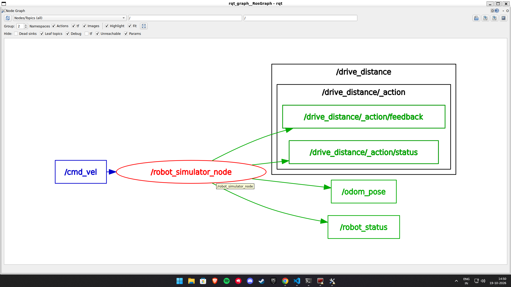

# ROS 2 Robot Control & Telemetry System

A C++17-based robot simulation project built with **ROS 2 Jazzy** and `rclcpp`. It simulates planar robot motion using velocity commands and time-based calculations, without requiring an external physics simulator.

## Features

- Simulated planar robot motion using linear and angular velocities.
- Odometry and robot telemetry publishing.
- Custom ROS 2 message, service, and action interfaces.
- Distance-based movement action with feedback and result.
- Runtime parameter configuration.
- QoS configuration.
- GoogleTest-based unit testing.

## Architecture

The system uses a central node, `/robot_simulator_node`, to manage robot motion and communication.

| Interface | Name | Type |
|---|---|---|
| Velocity command | `/cmd_vel` | Subscriber |
| Odometry | `/odom_pose` | Publisher |
| Robot telemetry | `/robot_status` | Publisher |
| Reset robot | `/reset_robot` | Service |
| Distance movement | `/drive_distance` | Action |

The `/drive_distance` action follows two phases: **rotation first, followed by translation**.

### Node Graph



## Project Structure

```text
ros2-robot-control-telemetry/
├── README.md
├── docs/
│   ├── images/
│   │   └── rqt_graph.png
│   └── integration.md
├── robot_control/
│   ├── config/
│   │   └── params.yaml
│   ├── include/robot_control/
│   │   └── robot_motion_utils.hpp
│   ├── launch/
│   │   └── robot.launch.py
│   ├── src/
│   │   └── robot_simulator_node.cpp
│   ├── test/
│   │   └── test_robot_simulator.cpp
│   ├── CMakeLists.txt
│   └── package.xml
└── telemetry_interfaces/
    ├── action/
    │   └── DriveDistance.action
    ├── msg/
    │   └── RobotStatus.msg
    ├── srv/
    │   └── ResetRobot.srv
    ├── CMakeLists.txt
    └── package.xml
```

## Prerequisites

- Ubuntu with ROS 2 Jazzy.
- C++17-compatible compiler.
- `colcon` and `rosdep`.

## Installation and Build

Create a ROS 2 workspace and clone the repository into its `src` directory:

```bash
mkdir -p ~/ros2_robot_control_telemetry_ws/src
cd ~/ros2_robot_control_telemetry_ws/src

git clone https://github.com/eswar7981/ros2-robot-control-telemetry.git .
```

Source ROS 2 and install dependencies:

```bash
source /opt/ros/jazzy/setup.bash

cd ~/ros2_robot_control_telemetry_ws
rosdep install --from-paths src --ignore-src -r -y
```

Build and source the workspace:

```bash
colcon build --symlink-install
source install/setup.bash
```

## Usage

### Launch the Simulator

```bash
ros2 launch robot_control robot.launch.py
```

### Publish Velocity Commands

```bash
ros2 topic pub /cmd_vel geometry_msgs/msg/Twist \
"{linear: {x: 1.0}, angular: {z: 1.0}}" --once
```

### Monitor Robot State

```bash
ros2 topic echo /odom_pose
ros2 topic echo /robot_status
```

### Reset the Robot

```bash
ros2 service call /reset_robot telemetry_interfaces/srv/ResetRobot "{}"
```

### Execute a Movement Goal

```bash
ros2 action send_goal /drive_distance \
telemetry_interfaces/action/DriveDistance \
"{target_distance: 20.0, rotation_angle: 90}" --feedback
```

## Parameters

The default parameters are defined in `robot_control/config/params.yaml`.

| Parameter | Default |
|---|---:|
| `max_linear_speed` | 1.0 |
| `max_angular_speed` | 1.0 |
| `publish_rate` | 10.0 Hz |

## Testing

The project uses GoogleTest for validating motion calculations and input constraints.

Run the tests:

```bash
colcon test --packages-select robot_control
colcon test-result --verbose
```

